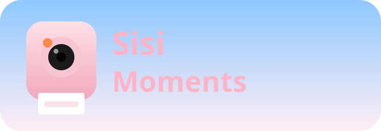

<p align="center">
  
</p>

# Sisi Moments

一个以家庭照片为主题的 3D 记忆展廊。仓库只包含代码、原创相机模型和项目品牌资产；照片与个人数据不进入 git。

## 体验

整个站点是一个连续的 Three.js 场景，没有首页与内页切换：

1. 入口是 Blender 建模的儿童房，拍立得与玩具共用空间和灯光。
2. 按快门后，相纸沿出纸口水平打印，镜头平移到同一世界里的展墙。
3. 鼠标拖动、滚轮或方向键左右浏览；到达边界后停止，不会因滑动退出画廊。
4. 点击照片推近，近景支持拖动平移、滚轮缩放和双指捏合；点击另一张照片直接对焦，点击当前照片或按 `Esc` 退出近景；画廊中按 `Esc` 回到相机。

房间不再使用照片背景。当前模型仍是空间原型，后续细化模型、材质与光照不需要重写交互。

场景支持 `prefers-reduced-motion`；启用减少动态效果时用短淡入淡出代替长镜头。

## 技术栈

- Vite + React + TypeScript
- Three.js：单一 renderer、相机、相纸、灯光、展墙和浏览镜头
- Cloudflare Workers + 静态资源
- 私有 R2：绑定名 `MOMENTS_BUCKET`，桶名 `sisi-moments`
- 发布主机名：`*.workers.dev`

Three.js 场景入口位于 `src/scene/createScene.ts`，React 只负责加载、键盘操作与可访问控件。

## 本地运行

```bash
npm install
cp .env.example .dev.vars
```

生成一个本地邀请令牌的哈希：

```bash
npm run hash-invite -- --salt '一长串随机盐' --invite 'local-only-token'
```

填写 `.dev.vars`：

```bash
ACCESS_SALT=一长串随机盐
ACCESS_INVITE_HASH=<上一条命令输出的 hex>
SESSION_SECRET=一长串随机串
```

```bash
npm run dev
```

打开本地地址后访问 `/i/local-only-token` 可换取长期会话。未登录时仍会显示内置示例内容和完整 3D 交互，但私有 R2 内容不会返回。

## 验证

```bash
npm run lint
npx tsc -b
npm run build
node --test tests/*.test.mjs
```

## 私有访问

旧版姓名门已移除。现在的流程是：

- 邀请链接：`/i/<opaque-token>`
- Worker 用 `ACCESS_SALT` 哈希令牌，与 `ACCESS_INVITE_HASH` 恒定时间比较
- 成功后写入 180 天有效的 HttpOnly `sm_session` Cookie
- `/api/moments` 与 `/api/media/*` 仍要求有效会话
- 失败请求按 isolate 限流

只把秘密放在 Cloudflare Secrets 或本地 `.dev.vars`：

| 名称 | 用途 |
| --- | --- |
| `ACCESS_SALT` | 邀请令牌哈希盐 |
| `ACCESS_INVITE_HASH` | `SHA-256(盐 + NUL + 邀请令牌)` |
| `SESSION_SECRET` | `sm_session` Cookie 的 HMAC 密钥 |

线上设置：

```bash
npx wrangler secret put ACCESS_SALT
npx wrangler secret put ACCESS_INVITE_HASH
npx wrangler secret put SESSION_SECRET
```

邀请链接本身也是秘密，不要发到公开群聊或提交到仓库。轮换令牌并更新 `ACCESS_INVITE_HASH` 只能阻止旧邀请继续兑换；要撤销已签发会话，还必须轮换 `SESSION_SECRET`。

## 照片与 R2

`wrangler.toml` 只包含绑定：

```toml
[[r2_buckets]]
binding = "MOMENTS_BUCKET"
bucket_name = "sisi-moments"
```

保持桶为私有，不要开启 `r2.dev` 公共访问。照片只通过 Worker 鉴权路由读取：

```text
GET /api/media/<object-key>
```

照片元数据可包含：

```json
{
  "id": "moment-001",
  "caption": "2025.06.08 · 1岁6个月",
  "src": "/api/media/moments/photo-001.jpg",
  "palette": "peach"
}
```

画廊布局由前端按内容顺序生成，R2 元数据不需要保存 CSS 坐标。

## 项目结构与模型流程

- `src/components/`：React 容器、加载与可访问交互
- `src/scene/createScene.ts`：单场景协调与动画状态
- `src/scene/`：世界加载、灯光、渲染、镜头、照片布局及资源生命周期
- `shared/`：前后端共用的照片类型与虚构示例数据
- `worker/`：邀请鉴权、私有媒体与分页接口
- `assets/source/`：Blender 源文件、建模脚本及锚点约定
- `public/models/`：运行时 GLB
- `assets/reference/legacy/`：旧方案参考资产，不进入站点静态资源

执行 `npm run assets:build` 会重新生成原型 `.blend` 和 `.glb`，覆盖手工修改。
手工精修 `.blend` 后使用 `npm run assets:export`，只导出 GLB。详见
[模型制作约定](assets/source/README.md)。两条命令都支持 `BLENDER_BIN` 指定 Blender。

所有模型为项目原创，不包含真实儿童照片、姓名、生日或第三方品牌素材。

## 部署

```bash
npm run deploy
```

需要 Cloudflare 账号、上面三个 Secrets，以及私有桶 `sisi-moments`。香港服务器反代阶段只需反代 `*.workers.dev` 站点，不反代 R2 桶。

## License

[MIT](LICENSE)
